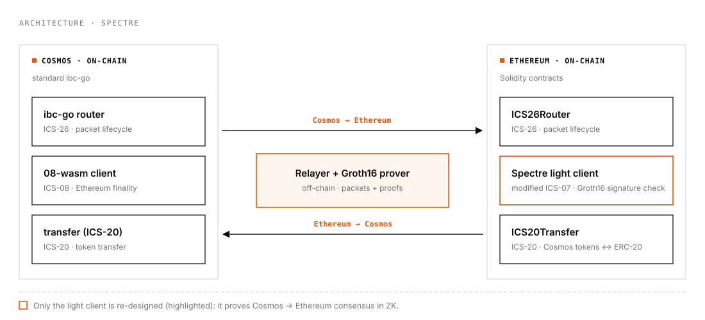

# Spectre

**Spectre is an implementation of IBC v2, with the goal of bringing IBC beyond Cosmos.**

Since IBC was built specifically for Cosmos, it can only support Cosmos-to-Cosmos connections. The main problem is its verification component — the Tendermint light client is too heavy to execute on any other chain. To bring IBC to a non-Cosmos chain, we turn to **ZK**: instead of *executing* the Tendermint light client there, we **enforce its logic by verifying a ZK proof of the light-client circuit**. The circuit is carefully built so that it is relatively light-weight, keeping the proving process fast and cheap.

Spectre is built to drop in cleanly: it **integrates into the IBC stack you already run**, so any chain that adopts it should expect the same IBC UX it has today.

---

## Table of contents

- [Architecture](#architecture)
- [Build](#build)
- [Runbooks](#runbooks)
- [GPU proving](#gpu-proving)
- [Logging](#logging)
- [Benchmark mode](#benchmark-mode)

---

## Architecture



| Highlight | Summary |
|---|---|
| **Hybrid design** | Only the validators' Ed25519 signature check is proven in ZK. Header checks and the finality threshold stay in Solidity, which keeps the circuit small |
| **Static circuit with buckets** | One gnark Groth16 circuit per signer count N ∈ {4, 8, 16, 32, 64, 128}. Each N is a **bucket**; the prover picks the smallest bucket that fits the signers |
| **Split `updateClient`** | `updateConsensusState` rotates the trusted validator set. `updateApplicationState` advances the block state for each packet and is the cheap, frequent call |
| **Input binding** | The proof has a single public input, a hash of the inputs that the circuit and the contract share |
| **Standard IBC elsewhere** | Ethereum → Cosmos uses the standard `08-wasm` client, with no ZK proof. Only the light client on the non-Cosmos chain is re-designed |

Details are in the [Spectre documentation](https://docs.trustless.link/docs/spectre):
[overview](https://docs.trustless.link/docs/spectre/foundations/overview-of-spectre) ·
[design choices](https://docs.trustless.link/docs/spectre/implementation/design-choices) ·
[light client](https://docs.trustless.link/docs/spectre/implementation/light-client) ·
[optimizations](https://docs.trustless.link/docs/spectre/implementation/optimizations) ·
[relayer](https://docs.trustless.link/docs/spectre/implementation/relayer) ·
[benchmark](https://docs.trustless.link/docs/spectre/performance/benchmark).

## Build

### Requirements

| Tool | Version | Needed for |
|---|---|---|
| [Go](https://golang.org/) | The version in `relayer/go.mod` | Relayer and prover |
| [Foundry](https://getfoundry.sh/) | | Contracts |
| [Bun](https://bun.sh/) | | Solidity dependencies (never npm or yarn) |
| [Just](https://github.com/casey/just) | | Build recipes |
| ICICLE runtime libraries | | GPU proving only; see [GPU proving](#gpu-proving) |

### gnark forks

The relayer and the prover depend on two private forks, pinned as ordinary Go
modules in `relayer/go.mod`:

```
require github.com/decentrio/ecip-gnark v0.1.0-rc.4

replace github.com/consensys/gnark => github.com/decentrio/gnark v0.16.4-decentrio-fork.5
```

| Fork | Content |
|---|---|
| [`decentrio/ecip-gnark`](https://github.com/decentrio/ecip-gnark) | Ed25519 operations inside the circuit. Pure Go: the relayer and prover build with `CGO_ENABLED=0` |
| [`decentrio/gnark`](https://github.com/decentrio/gnark) | Fork of consensys/gnark with changes to the generated verifier |

Both repositories are private, so the Go proxy and the checksum database cannot
serve them. Set this up once:

```bash
go env -w GOPRIVATE='github.com/decentrio/*'
gh auth setup-git        # or any other git credential for github.com/decentrio
```

To work on a fork, point a local `replace` at your checkout and never commit it:
machine-local paths do not belong in `go.mod`.

### Build and test

Run the build steps in this order on a fresh clone:

1. `bun install`: Solidity dependencies.
2. `just build-go-relayer`: `go build ./...` in `relayer/`.
3. `just build-prover-artifacts`: generates the **prover artifacts** of each
   bucket (`r1cs`, `pk`, `vk`) into `relayer/bin/n{N}/` and writes
   `contracts/verifiers/Groth16Verifier_N4.sol` plus the smoke proof used by
   `Groth16OnchainProofTest`. Only N=4 is built by default,
   and `relayer/bin/` is gitignored, so a fresh clone has none.
4. `just build-contracts`: `forge build`. This step needs the verifier from
   step 3, which is not checked in. The deploy scripts
   (`scripts/E2ETestDeploy.s.sol`, `scripts/E2ETestDeployL2.s.sol`) and two
   integration tests import it. Without it the build stops with
   `Source "contracts/verifiers/Groth16Verifier_N4.sol" not found`.

Tests and linters:

```bash
just test-foundry            # all Solidity tests
just test-go-relayer         # all Go relayer tests
just lint                    # solidity + go + buf (`just lint-rust` is separate)
```

`just --list` shows every recipe, including the per-L2 wasm builds, the attestor
services and Slither.

## Runbooks

| Document | Covers |
|---|---|
| [docs/runbooks/E2E_LOCAL.md](docs/runbooks/E2E_LOCAL.md) | Bringing up Cosmos↔Ethereum, Cosmos↔OP, Cosmos↔Arbitrum and Cosmos↔Base; sending test packets in both directions; the signing-key rules when several relayer processes run side by side; the failures each step can produce |
| [docs/runbooks/E2E_TESTNET.md](docs/runbooks/E2E_TESTNET.md) | Relaying against a public L2 testnet (OP Sepolia, Arbitrum Sepolia, Base Sepolia): values to fill in by hand, provider limits |
| [docs/runbooks/L2_CLIENTS.md](docs/runbooks/L2_CLIENTS.md) | The CosmWasm clients for OP, Base and Arbitrum: client state and profile, attestor rotation, the signed update contract, provisional attestations, validation |
| [docs/runbooks/PRODUCTION_DEPLOYMENT.md](docs/runbooks/PRODUCTION_DEPLOYMENT.md) | The production AccessManager deployment scripts: governance timelock, escrow launch gate, scheduled light-client provisioning. Read it before using those scripts |
| [docs/runbooks/ATTESTOR.md](docs/runbooks/ATTESTOR.md) | Operating and recovering the attestor services |
| [docs/runbooks/MISBEHAVIOUR.md](docs/runbooks/MISBEHAVIOUR.md) | Responding to misbehaviour (equivocation) on the Cosmos chain |
| [docs/runbooks/ERC20_LOCKBOX_ADAPTER.md](docs/runbooks/ERC20_LOCKBOX_ADAPTER.md) | Deploying and operating an ERC20 lockbox adapter |

## GPU proving

The prover runs on the CPU by default. GPU proving needs a build with
`-tags=icicle` and is then switched on per run.

| Requirement | Detail |
|---|---|
| GPU | NVIDIA, with a working CUDA driver and toolkit |
| ICICLE runtime libraries | `libicicle_device`, `libicicle_field_bn254`, `libicicle_curve_bn254`, visible to the linker and the loader |
| Build tag | The relayer and the artifact generator are built or run with `-tags=icicle` |

If the libraries are not in a default loader path, export `LD_LIBRARY_PATH`
before building or running:

```bash
export LD_LIBRARY_PATH=/usr/local/lib:${LD_LIBRARY_PATH}
```

| Backend | Selected by |
|---|---|
| CPU | Default |
| GPU | `GPU_PROVE=1` or `--gpu-prove` |

```bash
# Generate prover artifacts with the GPU backend
cd relayer
go run -tags=icicle ./prover/cmd -gpu-prove ./bin ../contracts/verifiers

# Build a relayer binary with ICICLE support
go build -tags=icicle -o relayer ./cmd

# Run the relayer on GPU
./relayer start --config config.json --gpu-prove

# The same, with the environment variable
GPU_PROVE=1 ./relayer start --config config.json
```

If the ICICLE runtime is missing, the `icicle` build fails at link time or at
startup with an error such as `library 'icicle_device' not found`. Install the
ICICLE shared libraries and make sure `LD_LIBRARY_PATH` covers the directory
that holds the `libicicle_*` files.

### Regenerating prover artifacts

**Regenerating prover artifacts changes the verifying key.** After any
regeneration, every deployed `Groth16Verifier_N{N}` must be redeployed and
registered again with `SignatureVerifier.setBucket(...)`, or every proof fails
on-chain. Do not regenerate for a live deployment before that redeploy is agreed.

| Path | Behavior |
|---|---|
| `just build-prover-artifacts` (`scripts/solidity/build-prover-artifacts.sh`) | The supported path. Covers the configured buckets (N4 by default). Generates into ignored staging (`.artifacts/solidity/prover`), smoke-tests it, checks that the staged set is complete, publishes it (including the smoke proof used by `Groth16OnchainProofTest`) and records provenance. Does nothing when every artifact exists, unless `--force` is passed. It does not pass `-tags=icicle`, so it cannot use the GPU backend |
| `go run ./prover/cmd …` (the example above) | Writes straight into `relayer/bin` and `contracts/verifiers` |

### ICICLE environment

Optional tuning variables, read by `relayer/prover/gnark/backend_icicle.go`:

| Variable | Meaning | Example |
|---|---|---|
| `GNARK_ICICLE_DEVICE_ID` | GPU device index | `0` |
| `GNARK_ICICLE_BACKEND_LIBS` | Backend library location passed to ICICLE | `/usr/local/lib` |
| `GNARK_ICICLE_PIN_KEYS` | Whether proving keys are pinned to GPU memory | `true` |

## Logging

Every log line of the relayer carries a level, so a log viewer can filter and
alert on it. The two settings are global flags, accepted by every subcommand.
Each has an environment variable; the flag takes precedence.

```bash
./relayer start --config config.json --log-level warn --log-format json

# The same, with environment variables
RELAYER_LOG_LEVEL=debug RELAYER_LOG_FORMAT=console ./relayer start --config config.json
```

| Flag / variable | Values | Default |
|---|---|---|
| `--log-level` / `RELAYER_LOG_LEVEL` | `debug`, `info`, `warn`, `error` | `info` |
| `--log-format` / `RELAYER_LOG_FORMAT` | `json`, `console`, `auto` | `auto`: `console` on a terminal, `json` otherwise |

The notes for operators (where the variables are read from, the JSON fields,
failed commands, gnark lines) are in
[docs/runbooks/E2E_LOCAL.md](docs/runbooks/E2E_LOCAL.md#relayer-logs).

## Benchmark mode

Benchmark mode adds gas and timing lines for every transaction, so one
end-to-end run can be compared with another without a rebuild. It is off by
default. Either the flag or the environment variable turns it on:

```bash
./relayer start --config config.json --benchmark

RELAYER_BENCHMARK=1 ./relayer start --config config.json
```

At startup the relayer logs
`[bench] enabled: detailed gas/timing logs are active`.

| Prefix | Emitted | Fields |
|---|---|---|
| `[bench] eth` | Per `SendEthTx` / `SendEthTxBatch` (`relayer/transaction/ethereum.go`) | Label or `multicall labels=...`, `gasUsed`, `submit`, `wait`, `total`, `tx` |
| `[bench] eth inner[i]` | Per inner call of a multicall | `label`, `gas` from the `callTracer` of `debug_traceTransaction` |
| `[bench] cosmos batch` | Per confirmed Cosmos transaction (`relayer/transaction/cosmos.go`) | `msgs`, `gasWanted`, `gasUsed`, `broadcast`, `height`, `hash` |
| `[bench] cosmos batch` | Per `SendCosmosTxBatch` call, which can split into several transactions | `msgs`, `total` |

The `[prover]` lines do not depend on benchmark mode. The prover
(`relayer/prover/prover.go`) logs `proof_id`, `bucket` and `witness` when a
proof job is queued, and `done in <duration>` when it finishes.

### Gas per inner call

`SendEthTxBatch` packs N inner calls into one transaction, and the receipt
reports only the total gas. After the transaction confirms, the relayer calls
`debug_traceTransaction` with the `callTracer`, descends past the UUPS proxy and
implementation frames, and logs one `inner[i]` line per direct child of the
multicall body:

```
[bench] eth multicall labels=updateApplicationState,recvPacket:1 gasUsed=<total> ...
[bench] eth inner[0] updateApplicationState gas=<n> (from trace)
[bench] eth inner[1] recvPacket:1 gas=<n> (from trace)
```

`gas=... (from trace)` is the gas that inner call used on-chain, as reported by
the trace.

The trace needs an RPC endpoint that exposes the `debug_` namespace
(`--http.api=...,debug` on geth). To check:

```bash
curl -X POST <rpc> -d '{"jsonrpc":"2.0","method":"rpc_modules","params":[],"id":1}'
# look for "debug": "1.0" in the response
```

If the namespace is not available, the relayer logs one `warn` line and
continues. The rest of the benchmark output is not affected.

Tests can force the mode with `utils.SetBenchEnabled(true|false)`, without
touching the environment. The definitions are in `relayer/utils/bench.go`.
